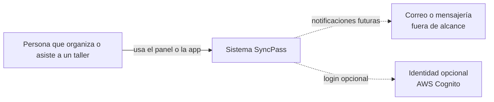
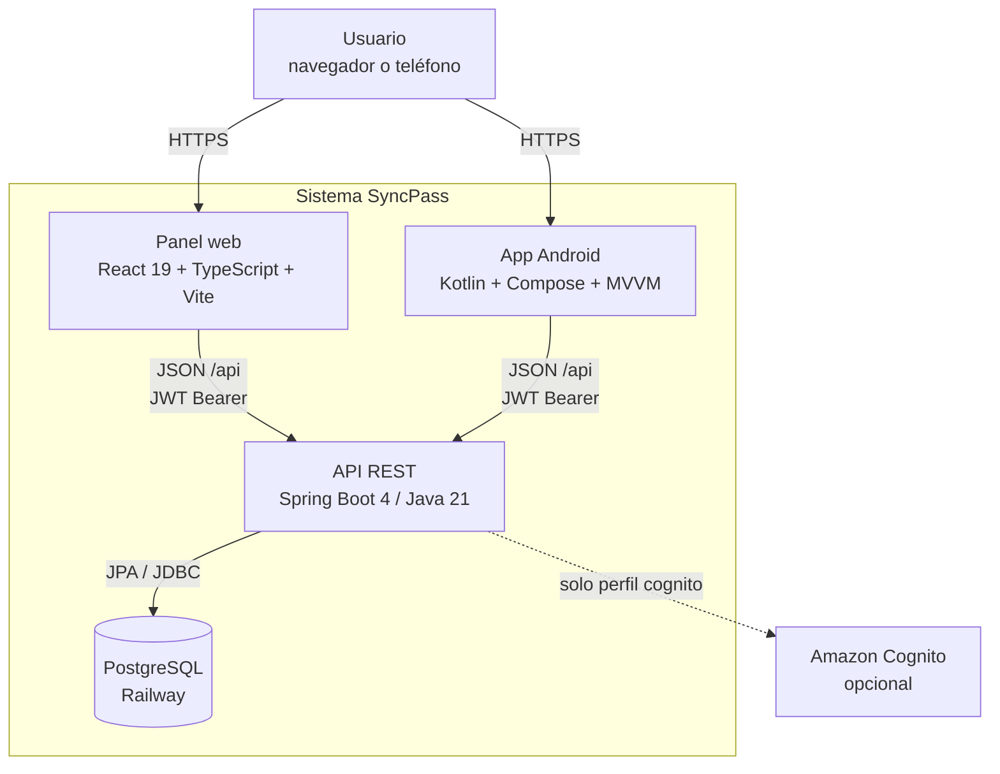
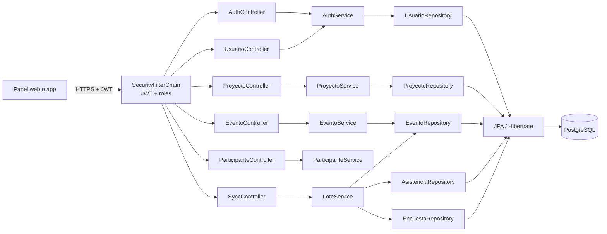
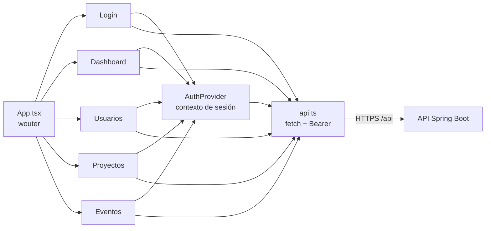
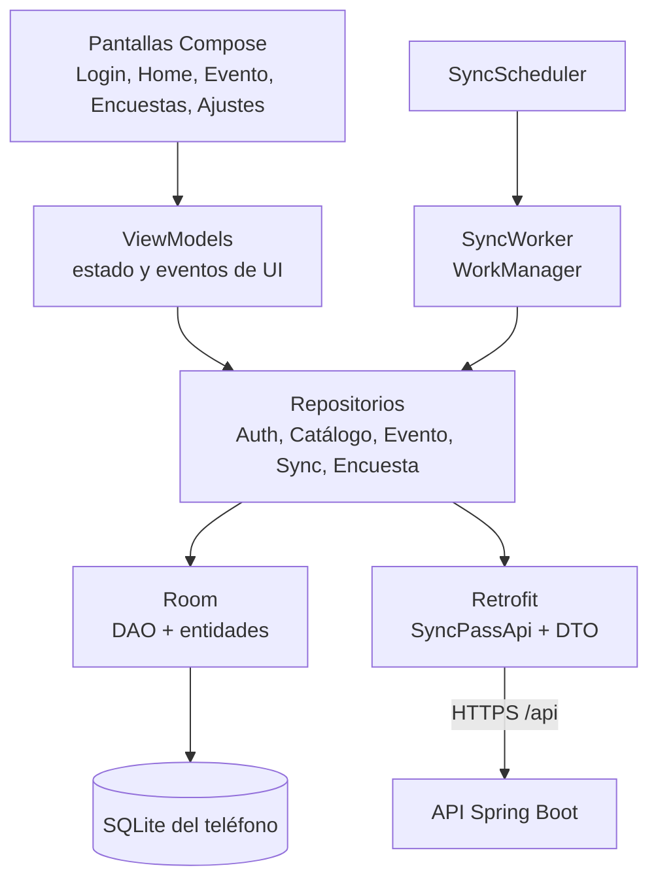
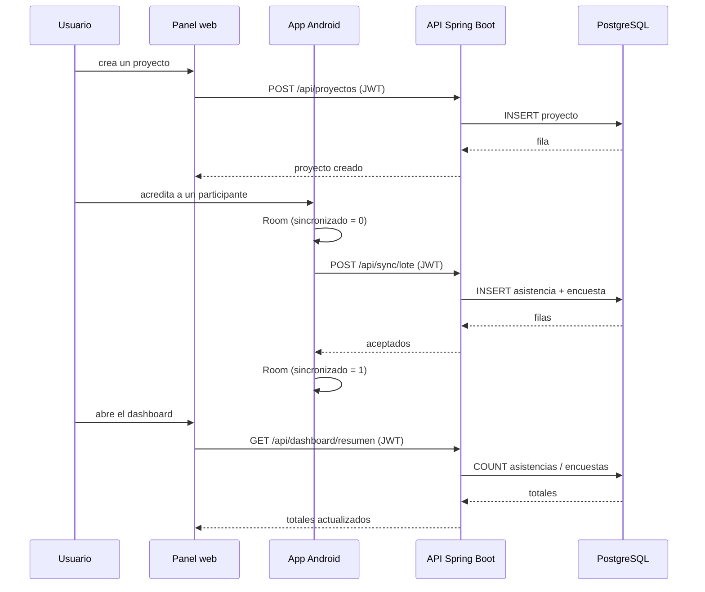

# Arquitectura C4 de SyncPass

Documento para la entrega de DAM (DSY1105) y DFS (DSY1104). Sigue el modelo C4 que pidió el profesor: **C1 contexto**, **C2 contenedores** y **C3 componentes** por aplicación. Los diagramas están en Mermaid para que se rendericen dentro del repositorio, sin depender de una herramienta externa.

## C1 — Contexto

El sistema resuelve un caso acotado: organizar proyectos y talleres, acreditar participantes y recoger encuestas. No incluye pagos, correo real ni una app de participantes separada.

## C2 — Contenedores

| Contenedor | Responsabilidad | Dónde vive |
| --- | --- | --- |
| Panel web | Login, dashboard, usuarios, proyectos y eventos. No habla con la base: solo con la API. | Servido por el mismo Spring Boot en `/`; fuente en `syncpass-web`. |
| App Android | Login, catálogo offline, acreditación por QR o código, encuestas y sincronización. Room es la fuente local; Retrofit es la única capa que conoce HTTP. | APK firmado; fuente en `syncpass-mvp`. |
| API | Autenticación, roles, reglas de negocio, idempotencia y persistencia. Es el único que toca PostgreSQL. | Railway; fuente en `syncpass-api`. |
| Base de datos | Proyectos, eventos, usuarios, asistencias y encuestas. | PostgreSQL administrado por Railway. |

## C3 — Componentes de la API

**Recorrido de un botón:** un controlador recibe el DTO y valida; el servicio aplica la regla (rol, cupo, estado, idempotencia); el repositorio consulta o escribe; Hibernate traduce a SQL; PostgreSQL guarda. La respuesta vuelve por el mismo camino.

Reglas que el profesor puede preguntar:

- El rol no lo decide el front: viaja en el JWT y se exige con `@PreAuthorize`.
- `POST /api/sync/lote` es idempotente por `(eventoId, usuarioId)`; reenviar no duplica.
- La transacción del lote es atómica: si una fila se rechaza, no se aplica ninguna.
- La API no expone la base: solo los repositorios la conocen.

## C3 — Componentes del panel web

| Capa | Archivos | Qué hace |
| --- | --- | --- |
| Rutas | `src/App.tsx` | Decide qué página se ve y aplica el guard por rol. |
| Páginas | `src/pages/*.tsx` | Formularios y tablas; no conocen la URL de la API. |
| Componentes | `src/components/Nav.tsx` | Navegación reutilizable. |
| Sesión | `src/auth.tsx` | Guarda el token y decodifica el rol. |
| Cliente HTTP | `src/api.ts` | Único lugar que conoce `VITE_API_URL` y el formato de las respuestas. |
| Estilos | `src/index.css` | Sistema visual propio, sin CDN. |

**Recorrido de un botón:** el formulario llama a una función de `api.ts`; `api.ts` agrega el token y hace `fetch`; la API responde; la página actualiza el estado. Si cambia la URL de la API, solo se toca `api.ts` o la variable de entorno.

## C3 — Componentes de la app Android

| Capa | Archivos | Qué hace |
| --- | --- | --- |
| UI | `ui/screens/*.kt`, `ui/components/*.kt` | Muestra estado y dispara acciones; no conoce HTTP ni Room. |
| ViewModel | `ui/viewmodel/*.kt` | Expone estado inmutable y orquesta casos de uso. |
| Repositorios | `data/repository/*.kt` | Deciden si leen de Room o de la API y mapean DTO/entidad. |
| Remoto | `data/remote/SyncPassApi.kt`, `NetworkModule.kt` | Única capa que conoce Retrofit y la URL base. |
| Local | `data/local/*.kt` | Única capa que conoce Room y SQLite. |
| Trabajo en segundo plano | `sync/SyncWorker.kt`, `sync/SyncScheduler.kt` | Reintenta la cola pendiente cuando hay red. |

**Recorrido de un botón:** la pantalla llama al ViewModel; el ViewModel llama al repositorio; el repositorio escribe en Room con `sincronizado=0` y encola el trabajo; el worker toma la cola y la envía por Retrofit; la API responde y el repositorio marca `sincronizado=1`. Si no hay red, el dato queda en Room y se reintenta.

## Conexión completa

## Límites declarados

- El panel se sirve desde el mismo Spring Boot para simplificar el despliegue; sigue siendo un front React separado en código y en repositorio.
- Cognito está implementado como perfil alternativo, pero la entrega usa login local con usuarios sembrados.
- La lectura de QR con cámara física no se volvió a probar en la última publicación; el ingreso manual por código sí está cubierto.
- El servicio de Railway puede dormir sin tráfico; la base y los datos permanecen.
